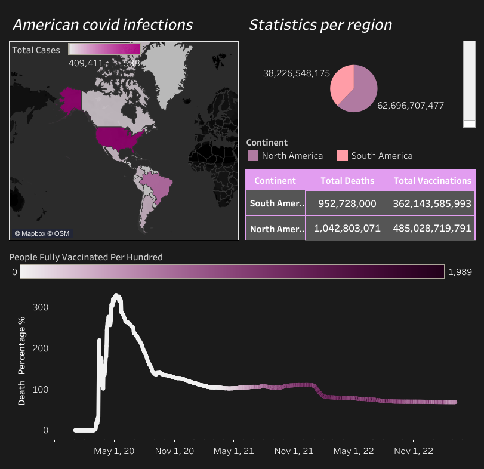
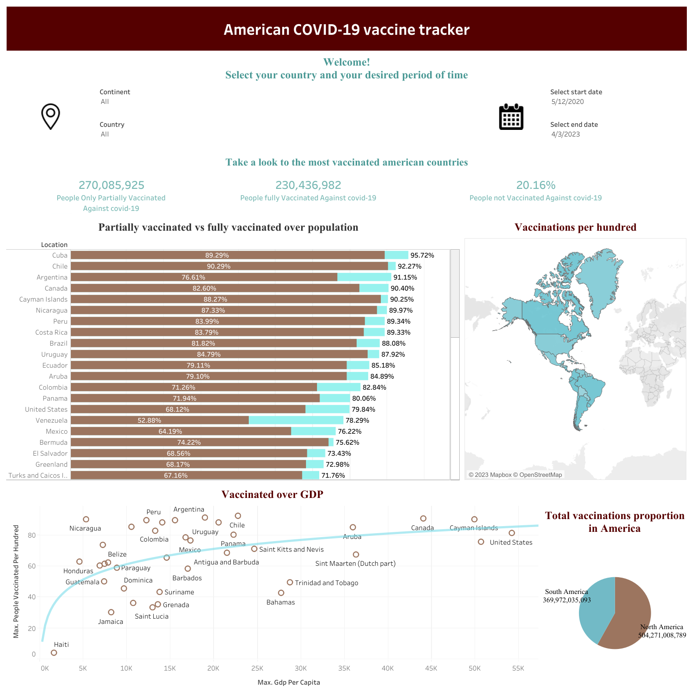

# COVID-19 in the Americas | SQL Analysis & Tableau Dashboards

**SQL · Exploratory Data Analysis · Data Quality · Tableau**

## Overview

This project explores reported COVID-19 cases, deaths, and vaccination records across countries in **North America and South America**. SQL is used to inspect source data, combine daily records, calculate descriptive ratios, and compare country-level indicators. Two Tableau dashboards present the analysis visually.

[**View the SQL analysis**](Covid_Analysis.sql) · [**Cases & deaths dashboard**](https://public.tableau.com/views/CovidAnalysis_16815283795840/Dashboard1?:language=en-US&publish=yes&:display_count=n&:origin=viz_share_link) · [**Vaccination dashboard**](https://public.tableau.com/shared/SWSZGG34Q?:display_count=n&:origin=viz_share_link)

## Research Questions

- How do reported COVID-19 cases and deaths differ across countries in the Americas?
- How do cumulative reported cases compare with country populations?
- How do recorded vaccination totals and coverage differ between countries?
- What data-quality considerations affect these comparisons?

## Dataset

The original SQL analysis uses two source tables in a Microsoft SQL Server database:

| Table | Main fields used |
|---|---|
| `PortfolioProject1.dbo.CovidDeaths` | `continent`, `location`, `date`, `population`, `total_cases`, `total_deaths`, `new_deaths` |
| `PortfolioProject1.dbo.CovidVaccinations` | `location`, `date`, `total_vaccinations`, `new_vaccinations`, `people_fully_vaccinated_per_hundred` |

Only country records labeled **North America** or **South America** in the deaths table are included. The underlying CSV/database files are **not committed to this repository**, so exact dataset row counts, date range, and source snapshot cannot be independently confirmed from the repository alone. To reproduce the queries, provide compatible source tables with these columns.

## Methodology

1. Inspect row coverage, locations, missing values, and duplicate country–date keys.
2. Match case/death records with vaccination records by country and date.
3. Create a reusable analytical view; preserve missing values as `NULL` rather than replacing them with zero.
4. Calculate the recorded cumulative deaths-to-cases ratio and cumulative cases-to-population ratio with zero-denominator protection.
5. Compare maximum reported cumulative counts, sums of reported daily deaths, and the latest available vaccination totals.
6. Visualize selected indicators in Tableau.

The queries are written for **Microsoft SQL Server (T-SQL)**. The SQL file builds a database view and does not overwrite the original input tables.

## Dashboards

### Cases and deaths

[**Open the interactive COVID-19 dashboard in Tableau Public**](https://public.tableau.com/views/CovidAnalysis_16815283795840/Dashboard1?:language=en-US&publish=yes&:display_count=n&:origin=viz_share_link)



### Vaccination

[**Open the interactive vaccination dashboard in Tableau Public**](https://public.tableau.com/shared/SWSZGG34Q?:display_count=n&:origin=viz_share_link)



These screenshots are snapshots of the Tableau dashboards; the linked interactive versions may depend on Tableau Public availability.

## Project Structure

```text
American-Covid-Analysis/
├── Covid_Analysis.sql           # SQL exploration, checks, and analytical queries
├── Covid-Dashboard.png          # Cases/deaths dashboard preview
├── Covid-Vaccines-Dashboard.png # Vaccination dashboard preview
└── README.md
```

## How to Reproduce

1. Create a Microsoft SQL Server database named `PortfolioProject1` (or update the database references in the SQL script).
2. Import the historical `CovidDeaths` and `CovidVaccinations` source datasets into the `dbo` schema, retaining the fields listed above.
3. Run [`Covid_Analysis.sql`](Covid_Analysis.sql) in SQL Server Management Studio or another compatible SQL Server client.
4. Inspect the query outputs and open the linked Tableau dashboards to explore the visual presentation.

The source data and Tableau workbook files are not bundled here; reproducing the exact dashboard snapshots would require their original underlying data extracts and workbook configurations.

## Limitations

- The data snapshot date and source provenance have not been verified from files in this repository. Figures should not be interpreted as current COVID-19 statistics.
- Reported cases and deaths depend on testing, surveillance coverage, and retrospective reporting corrections.
- Cumulative cases divided by population is **not** the percentage of unique people infected, since reinfections may be included.
- Recorded deaths divided by recorded cases is a descriptive ratio, **not** an infection-fatality rate.
- The latest nonmissing vaccination observation may occur on a different date for each country.
- The SQL checks flag duplicate country–date keys, but a source-data review is required before making definitive cross-country comparisons.

---

**Portfolio:** [Data Science & Analytics Portfolio](https://github.com/ClaudethClarissa/data-science-portfolio)
